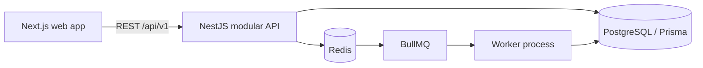

# 🚀 Advanced Multi-Tenant Subscription Management & Revenue Intelligence Platform

An evolving subscription management platform for recurring revenue businesses. The project is designed around a modular NestJS monolith, a Next.js application, PostgreSQL, and Redis/BullMQ workers. Its goal is to support the complete subscription workflow—from customers and plans through recurring billing, payment collection, financial records, and revenue intelligence.

> **Implementation status:** this repository currently contains the Phase 1 foundation only. The feature descriptions below are the product direction, not claims that those modules are already implemented or production ready. See [Implemented now](#-implemented-now) and [Roadmap](#-roadmap--feature-priority) for current status.

---

## 📑 Table of Contents

- [Overview](#-overview)
- [Key Features](#-key-features)
- [Implemented Now](#-implemented-now)
- [System Architecture](#-system-architecture)
- [Technology Stack](#-technology-stack)
- [Database Schema & Ledger Model](#-database-schema--ledger-model)
- [API & Webhook Documentation](#-api--webhook-documentation)
- [Installation & Local Setup](#-installation--local-setup)
- [Configuration & Environment Variables](#-configuration--environment-variables)
- [Background Workers & Automation](#-background-workers--automation)
- [Testing & Quality Assurance](#-testing--quality-assurance)
- [Deployment & DevOps](#-deployment--devops)
- [Roadmap & Feature Priority](#-roadmap--feature-priority)
- [License & Support](#-license--support)

---

## 🌐 Overview

Subscription businesses need reliable handling of plan changes, renewals, usage, payment failures, and financial history. This project aims to bring those workflows together in one tenant-aware platform while keeping billing correctness and auditability in the backend.

The planned system builds on a modular monolith. Domain modules will remain in one deployable API initially, with asynchronous work delegated to BullMQ workers. PostgreSQL is intended to remain the source of truth; Redis is a job transport and cache, not the authority for financial state.

### Product goals

- Recurring subscriptions with flexible billing periods, trials, renewals, pauses, and plan changes.
- Usage metering, prepaid credits, and deterministic proration.
- Provider-neutral payment orchestration, beginning with a verified Razorpay integration.
- Append-only, double-entry financial records with explicit corrections.
- Tenant-scoped access, audit history, and customer self-service.
- Revenue analytics with defined metrics and visible data coverage.

These are goals for the project. Payment recovery, analytics, ledger, and billing workflows are not implemented yet.

## ✨ Key Features

The following sections describe the target platform behavior. Implementation status is tracked in the [roadmap](#-roadmap--feature-priority).

### 1. Automated recurring billing

The planned billing engine will schedule daily, weekly, monthly, quarterly, yearly, and custom intervals; generate invoices idempotently; track billing periods; and handle month-end dates, timezones, retries, and concurrent work. Database constraints and transactions will protect financial correctness even when queue jobs are delivered more than once.

### 2. Usage metering and credits

The planned metering module will ingest deduplicated events, aggregate usage by billing period, apply flat, tiered, volume, or stair-step prices, and snapshot invoiceable usage. Prepaid and promotional credits will use a transaction ledger rather than an editable balance alone. Late-arriving usage will follow a documented adjustment process and will not silently rewrite finalized invoices.

### 3. Double-entry financial ledger

The planned ledger will post balanced debit and credit entries for invoices, payments, tax, fees, refunds, and adjustments. Posted entries will be immutable; corrections will use reversals or compensating transactions. Revenue recognition policy will be configurable and will not be presented as a complete accounting policy by default.

### 4. Subscription lifecycle and proration

The planned lifecycle supports trials, activation, renewal, pauses, resumption, plan/quantity/add-on changes, scheduled cancellation, immediate cancellation, expiration, and reactivation. Proration will be a deterministic server-side calculation with explicit currency precision and billing-period boundaries.

### 5. Dunning and payment recovery

The planned dunning workflow will classify failures, notify customers, schedule configurable retries, track recovery, and suspend or reactivate subscriptions according to tenant policy. Recovery links will be scoped, expiring tokens. Permanent failures will not be retried as if they were transient.

### 6. Payment gateway orchestration

The planned adapter boundary will isolate provider-specific behavior. Razorpay is the first target integration; Stripe is optional. Payment state will be verified with trusted provider APIs and signed webhooks, never inferred from a browser redirect. Webhook events will be persisted, deduplicated, and processed asynchronously.

### 7. Revenue intelligence

The planned analytics module includes MRR, ARR, ARPU, CLV, logo and revenue churn, NRR, GRR, retention, cohorts, overdue invoices, and recovery metrics. Metric definitions will specify treatment of discounts, refunds, tax, credits, trials, paused subscriptions, and currencies. Forecasting will only be enabled when the underlying data is sufficient and will expose assumptions and limitations.

## ✅ Implemented Now

- pnpm workspace with `apps/web`, `apps/api`, and `apps/worker`.
- Next.js App Router landing shell.
- NestJS API with the versioned process health route `GET /api/v1/health`.
- PostgreSQL and Redis local-service configuration in Docker Compose.
- Prisma 7 schema for tenants, users, memberships, roles, and permissions.
- Generated initial PostgreSQL migration for those identity and tenancy tables.
- Prisma PostgreSQL adapter and API startup database connection.
- BullMQ worker process shell; no business job handlers are registered yet.
- Environment template and initial architecture, database, and security notes.

Not implemented: registration/login, tenant authorization, RLS, customer/catalog workflows, subscriptions, invoices, payment integrations, dunning, usage, credits, ledger, reconciliation, webhooks, analytics, customer portal, or production deployment configuration.

## 🏗️ System Architecture

The diagram shows the intended architecture. Today, only the web shell, API health route, database schema/migration, and worker shell exist. There is no API gateway module beyond NestJS routing, no webhook processor, and no production queue consumer.

Planned domain boundaries include Authentication, Tenants, Users/RBAC, Customers, Catalog, Pricing, Quotations, Subscriptions, Billing, Metering, Credits, Proration, Invoices, Payments, Dunning, Tax, Ledger, Reconciliation, Analytics, Webhooks, Notifications, and Audit. The API remains a modular monolith; microservices are not part of the initial design.

See [architecture overview](docs/architecture/overview.md) and [security baseline](docs/security/baseline.md).

## 🧰 Technology Stack

| Area | Selected technology |
| --- | --- |
| Web | Next.js 16.4.3, React 19.3.1, TypeScript 6.0.3 |
| API | NestJS 12.3.2, TypeScript 6.0.3, REST under `/api/v1` |
| Data | PostgreSQL 17 container, Prisma 7.10.1, `@prisma/adapter-pg` |
| Worker | BullMQ 6.5.3, Redis 8.2.1 container |
| Local infrastructure | Docker Compose |

Dependency versions are pinned in workspace manifests and `pnpm-lock.yaml`. The project requires Node.js 20.19 or newer for Prisma 7.10.1.

## 🗄️ Database Schema & Ledger Model

The current schema contains only identity and tenancy foundations: `Tenant`, `User`, `Membership`, `Role`, `Permission`, `MembershipRole`, and `RolePermission`. It does **not** yet contain billing, payment, or ledger tables.

The planned data model will use tenant-aware foreign keys and unique constraints for business entities. Money will use integer minor units or fixed-precision database decimals, never binary floating point. Finalized invoice snapshots and posted ledger entries will be immutable. Each posted journal transaction must balance debits and credits atomically. PostgreSQL RLS is planned as defense in depth after tenant context has been added to API and worker processing.

See the [database design notes](docs/database/README.md). The initial SQL migration is at `apps/api/prisma/migrations/20261031100000_foundation/migration.sql`; it has been generated but not applied in this environment.

## 🔌 API & Webhook Documentation

Current route:

| Method | Route | Behavior |
| --- | --- | --- |
| `GET` | `/api/v1/health` | Returns process status and timestamp |

Customer, product, plan, quotation, subscription, billing, invoice, payment, usage, credit, analytics, and ledger routes are planned only. OpenAPI/Swagger is not configured yet. Incoming or outgoing webhooks are not implemented.

When those APIs are added, public DTOs will be separated from database models and routes will include validation, pagination, authorization, tenant scope, and consistent error responses.

## ⚙️ Installation & Local Setup

### Requirements

- Node.js 20.19 or newer
- pnpm 10.20.0 (via Corepack or `npx`)
- Docker Engine and Docker Compose

### Start the foundation

1. Copy `.env.example` to `.env`.
2. Start PostgreSQL and Redis: `docker compose up -d postgres redis`.
3. Install dependencies: `npx pnpm@10.20.0 install`.
4. Generate Prisma Client: `npx pnpm@10.20.0 db:generate`.
5. Apply the initial migration: `npx pnpm@10.20.0 db:migrate`.
6. Start the web app and API: `npx pnpm@10.20.0 dev`.
7. In another terminal, start the worker shell: `npx pnpm@10.20.0 dev:worker`.

Web app: http://localhost:3000  
API health: http://localhost:4000/api/v1/health

The API opens a database connection at startup. The health route currently reports process health only; it does not report database or Redis readiness. Docker Compose credentials and exposed ports are for local development only.

## 🔐 Configuration & Environment Variables

`.env.example` lists database, Redis, app/API URLs, JWT placeholders, Razorpay/Stripe placeholders, email, storage, and log-level settings. No real credentials are included. Most integration variables are placeholders because those integrations are not implemented yet. JWT values are not consumed until authentication is added.

Never commit `.env` or use the local Compose credentials in a shared environment. Deployment should load secrets from an appropriate secret manager. See [security baseline](docs/security/baseline.md).

## ⏱️ Background Workers & Automation

The worker shell connects to the `platform` BullMQ queue and shuts down on SIGINT/SIGTERM. There are no billing, dunning, notification, usage aggregation, or webhook jobs yet. Unknown job types fail explicitly.

The planned event flow uses a PostgreSQL transactional outbox: commit business state and the outbox record together, publish asynchronously, and process at least once with idempotent consumers. Redis locks alone will not protect financial correctness.

## 🧪 Testing & Quality Assurance

No automated tests have been added yet. The following checks were run for the foundation using Node 22.16.0:

- `pnpm -r typecheck` — passed for web, API, and worker.
- `pnpm -r build` — passed for web, API, and worker.
- `prisma generate` — passed.

Database migrations were not applied and no integration or end-to-end flows were run because Docker/PostgreSQL are unavailable in the current workspace. Unit, integration, tenant-isolation, billing edge-case, webhook, and browser tests remain planned. Do not interpret build success as production-readiness.

## 🚢 Deployment & DevOps

Docker Compose currently provisions only local PostgreSQL and Redis. It does not build or deploy the application services. CI/CD, production container images, Nginx, metrics, OpenTelemetry, backup/recovery, and deployment procedures are not configured yet. The sub-two-second response objective in the product requirements remains an unmeasured target.

## 🗺️ Roadmap & Feature Priority

1. **Foundation completion:** run PostgreSQL/Redis, apply migration, add readiness checks, structured logging, and configuration validation.
2. **Identity and tenancy:** registration/login, refresh-token rotation, tenant context, permissions, audit events, and cross-tenant isolation checks.
3. **Core subscription workflow:** customers, catalog, plans/prices, quotations, subscription state machine, and event history.
4. **Billing and invoices:** billing periods, discounts, tax snapshots, invoice finalization, idempotency, and scheduled runs.
5. **Payments:** provider adapter, Razorpay sandbox flow, signature-verified webhook processing, refunds, and reconciliation.
6. **Advanced billing:** proration, usage event ingestion/aggregation, prepaid credits, and configurable dunning.
7. **Financial records:** chart of accounts, balanced journals, reversals, settlement matching, and exception resolution.
8. **Customer and insights:** self-service portal, metric definitions, analytics snapshots, reports, and evaluated forecasting.
9. **Production readiness:** automated unit/integration/E2E/security tests, performance evaluation, CI/CD, deployment, and recovery documentation.

## 📄 License & Support

This project is licensed under the MIT License; see [LICENSE](LICENSE). There is no support/SLA commitment at this development stage.
