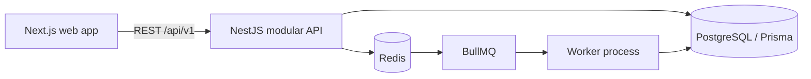

# 🚀 Advanced Multi-Tenant Subscription Management & Revenue Intelligence Platform

An evolving subscription management platform for recurring revenue businesses. The project is designed around a modular NestJS monolith, a Next.js application, PostgreSQL, and Redis/BullMQ workers. Its goal is to support the complete subscription workflow—from customers and plans through recurring billing, payment collection, financial records, and revenue intelligence.

> **Implementation status:** this repository currently contains the Phase 1 foundation only. The feature descriptions below are the product direction, not claims that those modules are already implemented or production ready. See [Implemented now](#-implemented-now) and [Roadmap](#-roadmap--feature-priority) for current status.

---

## 📑 Table of Contents

- [Overview](#-overview)
- [Key Features](#-key-features)
- [Implemented Now](#-implemented-now)
- [System Architecture](#-system-architecture)
- [Technology Stack](#-technology-stack)
- [Database Schema & Ledger Model](#-database-schema--ledger-model)
- [API & Webhook Documentation](#-api--webhook-documentation)
- [Usage Metering Architecture](#usage-metering-architecture)
- [Ledger and Reconciliation Architecture](#ledger-and-reconciliation-architecture)
- [GST and E-Invoicing Compliance](#gst-and-e-invoicing-compliance)
- [Dunning and Involuntary Churn Prevention](#dunning-and-involuntary-churn-prevention)
- [Revenue Forecasting and Explainability](#revenue-forecasting-and-explainability)
- [Revenue Leakage Detection](#revenue-leakage-detection)
- [Multi-Tenant Security Model](#multi-tenant-security-model)
- [Developer API and Webhooks](#developer-api-and-webhooks)
- [Reliability and Observability](#reliability-and-observability)
- [Installation & Local Setup](#-installation--local-setup)
- [Configuration & Environment Variables](#-configuration--environment-variables)
- [Background Workers & Automation](#-background-workers--automation)
- [Testing & Quality Assurance](#-testing--quality-assurance)
- [Deployment & DevOps](#-deployment--devops)
- [Roadmap & Feature Priority](#-roadmap--feature-priority)
- [License & Support](#-license--support)

---

## 🌐 Overview

Subscription businesses need reliable handling of plan changes, renewals, usage, payment failures, and financial history. This project aims to bring those workflows together in one tenant-aware platform while keeping billing correctness and auditability in the backend.

The planned system builds on a modular monolith. Domain modules will remain in one deployable API initially, with asynchronous work delegated to BullMQ workers. PostgreSQL is intended to remain the source of truth; Redis is a job transport and cache, not the authority for financial state.

### Product goals

- Recurring subscriptions with flexible billing periods, trials, renewals, pauses, and plan changes.
- Usage metering, prepaid credits, and deterministic proration.
- Provider-neutral payment orchestration, beginning with a verified Razorpay integration.
- Append-only, double-entry financial records with explicit corrections.
- Tenant-scoped access, audit history, and customer self-service.
- Revenue analytics with defined metrics and visible data coverage.

These are goals for the project. Payment recovery, analytics, ledger, and billing workflows are not implemented yet.

## ✨ Key Features

The following sections describe the target platform behavior. Implementation status is tracked in the [roadmap](#-roadmap--feature-priority).

### 1. Automated recurring billing

The planned billing engine will schedule daily, weekly, monthly, quarterly, yearly, and custom intervals; generate invoices idempotently; track billing periods; and handle month-end dates, timezones, retries, and concurrent work. Database constraints and transactions will protect financial correctness even when queue jobs are delivered more than once.

### 2. Usage metering and credits

The planned metering module will ingest deduplicated events, aggregate usage by billing period, apply flat, tiered, volume, or stair-step prices, and snapshot invoiceable usage. Prepaid and promotional credits will use a transaction ledger rather than an editable balance alone. Late-arriving usage will follow a documented adjustment process and will not silently rewrite finalized invoices.

### 3. Double-entry financial ledger

The planned ledger will post balanced debit and credit entries for invoices, payments, tax, fees, refunds, and adjustments. Posted entries will be immutable; corrections will use reversals or compensating transactions. Revenue recognition policy will be configurable and will not be presented as a complete accounting policy by default.

### 4. Subscription lifecycle and proration

The planned lifecycle supports trials, activation, renewal, pauses, resumption, plan/quantity/add-on changes, scheduled cancellation, immediate cancellation, expiration, and reactivation. Proration will be a deterministic server-side calculation with explicit currency precision and billing-period boundaries.

### 5. Dunning and payment recovery

The planned dunning workflow will classify failures, notify customers, schedule configurable retries, track recovery, and suspend or reactivate subscriptions according to tenant policy. Recovery links will be scoped, expiring tokens. Permanent failures will not be retried as if they were transient.

### 6. Payment gateway orchestration

The planned adapter boundary will isolate provider-specific behavior. Razorpay is the first target integration; Stripe is optional. Payment state will be verified with trusted provider APIs and signed webhooks, never inferred from a browser redirect. Webhook events will be persisted, deduplicated, and processed asynchronously.

### 7. Revenue intelligence

The planned analytics module includes MRR, ARR, ARPU, CLV, logo and revenue churn, NRR, GRR, retention, cohorts, overdue invoices, and recovery metrics. Metric definitions will specify treatment of discounts, refunds, tax, credits, trials, paused subscriptions, and currencies. Forecasting will only be enabled when the underlying data is sufficient and will expose assumptions and limitations.

## ✅ Implemented Now

- pnpm workspace with `apps/web`, `apps/api`, and `apps/worker`.
- Next.js App Router landing shell.
- NestJS API with the versioned process health route `GET /api/v1/health`.
- PostgreSQL and Redis local-service configuration in Docker Compose.
- Prisma 7 schema for tenants, users, memberships, roles, and permissions.
- Tenant API keys stored as hashes with scopes and expiry/revocation checks.
- Usage meter, customer, subscription, append-only event, and hourly/daily aggregate schema with an additive migration.
- `POST /api/v1/usage/events` with tenant-derived API-key scope, idempotency, payload conflict detection, and transactional aggregate updates.
- `GET /api/v1/usage/summary` with raw-versus-daily aggregate reconciliation over complete UTC-day windows.
- Seed and API-key CLI commands for an AI usage demo tenant.
- Prisma PostgreSQL adapter and API startup database connection.
- BullMQ worker process shell; no business job handlers are registered yet.
- Environment template and initial architecture, database, and security notes.

Not implemented: user registration/login, customer and catalog management workflows, subscription lifecycle APIs, billing/pricing calculations, invoice generation, usage billing-period snapshots or invoice adjustments, credits, payment integrations, dunning, financial ledger, gateway reconciliation, GST/e-invoicing, webhooks, analytics, customer portal, or production deployment configuration. Customer/subscription rows currently exist only as the minimal references needed by usage ingestion.

## 🏗️ System Architecture

The diagram shows the intended architecture. Today, only the web shell, API health route, database schema/migration, and worker shell exist. There is no API gateway module beyond NestJS routing, no webhook processor, and no production queue consumer.

Planned domain boundaries include Authentication, Tenants, Users/RBAC, Customers, Catalog, Pricing, Quotations, Subscriptions, Billing, Metering, Credits, Proration, Invoices, Payments, Dunning, Tax, Ledger, Reconciliation, Analytics, Webhooks, Notifications, and Audit. The API remains a modular monolith; microservices are not part of the initial design.

See [architecture overview](docs/architecture/overview.md) and [security baseline](docs/security/baseline.md).

## 🧰 Technology Stack

| Area | Selected technology |
| --- | --- |
| Web | Next.js 16.4.3, React 19.3.1, TypeScript 6.0.3 |
| API | NestJS 12.3.2, TypeScript 6.0.3, REST under `/api/v1` |
| Data | PostgreSQL 17 container, Prisma 7.10.1, `@prisma/adapter-pg` |
| Worker | BullMQ 6.5.3, Redis 8.2.1 container |
| Local infrastructure | Docker Compose |

Dependency versions are pinned in workspace manifests and `pnpm-lock.yaml`. The project requires Node.js 20.19 or newer for Prisma 7.10.1.

## 🗄️ Database Schema & Ledger Model

The current schema contains identity/tenancy foundations plus minimal `Customer`, `Subscription`, `UsageMeter`, append-only `UsageEvent`, `UsageAggregate`, and scoped `TenantApiKey` records. It does **not** yet contain invoice, payment, credit, tax, or ledger tables.

The planned data model will use tenant-aware foreign keys and unique constraints for business entities. Money will use integer minor units or fixed-precision database decimals, never binary floating point. Finalized invoice snapshots and posted ledger entries will be immutable. Each posted journal transaction must balance debits and credits atomically. PostgreSQL RLS is planned as defense in depth after tenant context has been added to API and worker processing.

See the [database design notes](docs/database/README.md). SQL migrations are under `apps/api/prisma/migrations`; neither migration has been applied in this environment.

## 🔌 API & Webhook Documentation

Current route:

| Method | Route | Behavior |
| --- | --- | --- |
| `GET` | `/api/v1/health` | Returns process status and timestamp |

Customer, product, plan, quotation, subscription lifecycle, billing, invoice, payment, credit, analytics, and ledger routes are planned only. Incoming or outgoing webhooks are not implemented. See the [implemented OpenAPI contract](docs/api/openapi.yaml) and [API notes](docs/api/README.md); Swagger UI is not configured in the running API.

When those APIs are added, public DTOs will be separated from database models and routes will include validation, pagination, authorization, tenant scope, and consistent error responses.

## ⚙️ Installation & Local Setup

### Requirements

- Node.js 20.19 or newer
- pnpm 10.20.0 (via Corepack or `npx`)
- Docker Engine and Docker Compose

### Start the foundation

1. Copy `.env.example` to `.env`.
2. Start PostgreSQL and Redis: `docker compose up -d postgres redis`.
3. Install dependencies: `npx pnpm@10.20.0 install`.
4. Generate Prisma Client: `npx pnpm@10.20.0 db:generate`.
5. Apply migrations using the migration-owner URL: `npx pnpm@10.20.0 db:migrate`.
6. Seed the usage demo: `npx pnpm@10.20.0 db:seed`.
7. Create a scoped API key for the printed tenant ID: `npx pnpm@10.20.0 --filter @brightloop/api api-key:create <tenant-uuid>`.
8. Start the web app and API: `npx pnpm@10.20.0 dev`.
9. In another terminal, start the worker shell: `npx pnpm@10.20.0 dev:worker`.

Web app: http://localhost:3000  
API health: http://localhost:4000/api/v1/health

The API opens a database connection at startup. The health route currently reports process health only; it does not report database or Redis readiness. Docker Compose credentials and exposed ports are for local development only.

## 🔐 Configuration & Environment Variables

`.env.example` lists database, Redis, app/API URLs, JWT placeholders, Razorpay/Stripe placeholders, email, storage, and log-level settings. No real credentials are included. Most integration variables are placeholders because those integrations are not implemented yet. JWT values are not consumed until authentication is added.

Never commit `.env` or use the local Compose credentials in a shared environment. Deployment should load secrets from an appropriate secret manager. See [security baseline](docs/security/baseline.md).

## ⏱️ Background Workers & Automation

The worker shell connects to the `platform` BullMQ queue and shuts down on SIGINT/SIGTERM. Usage hourly/daily aggregates are currently updated synchronously in the ingestion transaction; there are no billing, dunning, notification, scheduled aggregation, or webhook jobs yet. Unknown worker job types fail explicitly.

The planned event flow uses a PostgreSQL transactional outbox: commit business state and the outbox record together, publish asynchronously, and process at least once with idempotent consumers. Redis locks alone will not protect financial correctness.

## 🧪 Testing & Quality Assurance

The following automated checks were run using Node 22.16.0:

- `pnpm -r typecheck` — passed for web, API, and worker.
- `pnpm -r build` — passed for web, API, and worker before the latest usage extension; rerun after the latest edits is pending.
- `prisma generate` — passed.
- `pnpm --filter @brightloop/api test` — 2 usage-metering utility tests passed.

Database migrations were not applied and no integration or end-to-end flows were run because Docker/PostgreSQL are unavailable in the current workspace. Ingestion transaction, duplicate-request concurrency, RLS, cross-tenant access, worker, billing, webhook, and browser tests remain planned. Do not interpret build success as production-readiness.

## 🚢 Deployment & DevOps

Docker Compose currently provisions only local PostgreSQL and Redis. It does not build or deploy the application services. CI/CD, production container images, Nginx, metrics, OpenTelemetry, backup/recovery, and deployment procedures are not configured yet. The sub-two-second response objective in the product requirements remains an unmeasured target.

## Usage Metering Architecture

Implemented and pending details are in [usage metering architecture](docs/architecture/usage-metering.md). Raw events are append-only and aggregates are rebuildable projections. Invoice and ledger comparisons and late-usage adjustment documents await their respective modules.

## Ledger and Reconciliation Architecture

**Planned.** Every posted journal transaction will balance debits and credits and remain immutable. Corrections use reversal or compensating entries. Daily reconciliation will compare invoices, payments, refunds, gateway settlements, bank payouts, and ledger entries, creating classified `ReconciliationException` records. No ledger, revenue-recognition schedule, settlement import, or exception admin screen exists yet.

## GST and E-Invoicing Compliance

**Planned, not a compliance claim.** The tax module is intended to support CGST, SGST, IGST, UTGST, cess, B2B/B2C, place of supply, GSTIN checks, tax-inclusive/exclusive pricing, sequential tenant invoice numbering, credit/debit notes, eligible e-invoice submission, and GSTR-1/GSTR-3B reconciliation. Tax calculation, invoice issuance, e-invoice provider submission, and filing reconciliation will be separate workflows. Regulatory obligations and provider integrations require verification before any compliance claim.

## Dunning and Involuntary Churn Prevention

**Planned.** Payment attempt history, failure classification, configurable retry policies, recovery scoring, explanation signals, human overrides, and recovery analytics are future work. Automated recovery actions will remain auditable and should not treat a probability score as a payment fact.

## Revenue Forecasting and Explainability

**Planned.** Forecasts will account for renewal schedules, plan changes, discounts, credits, proration, churn, and uncertain usage revenue. Best/expected/worst scenarios and intervals will be labeled as decision support. Every prediction should retain model version, inputs, timestamp, confidence, explanation, and human override. No forecasting model is implemented.

## Revenue Leakage Detection

**Planned.** A leakage scanner will compare subscriptions, entitlements, usage, invoices, payments, credits, discounts, and ledger postings. Findings will become severity-ranked cases with root cause, financial impact, owner, status, and resolution audit history. No leakage detection currently runs.

## Multi-Tenant Security Model

The usage API derives tenant identity from a scoped API key and checks customer/subscription/meter relationships with composite tenant keys. RLS policies are included for usage-related tenant tables; transactions set `app.tenant_id` before querying them. Local Compose uses a restricted application role, separate from the migration owner. These controls cover only the usage slice. User authentication, full API/service/worker/cache/file/analytics isolation, tenant-aware rate limits, and immutable audit events remain incomplete. See [security baseline](docs/security/baseline.md).

## Developer API and Webhooks

**Partially implemented.** REST routes use `/api/v1`; usage API keys are scoped and money-changing idempotency patterns are planned. The current implemented route contract is in [OpenAPI YAML](docs/api/openapi.yaml). Cursor pagination, full API key lifecycle, webhook subscriptions/signing/retries/DLQ, sandbox data, API analytics, and Swagger UI are future work.

## Reliability and Observability

**Partially implemented.** PostgreSQL transactions protect raw usage ingestion and aggregate updates; unique indexes protect event IDs and tenant idempotency keys. Local Compose healthchecks exist for PostgreSQL and Redis. Distributed locks, outbox publishing, dead-letter management, provider circuit breakers, API/database/queue readiness checks, correlation IDs, metrics, alerting, backups, restore drills, and retention policies remain planned.

## 🗺️ Roadmap & Feature Priority

1. **Usage metering — active:** ingestion, idempotency, hourly/daily aggregates, and raw-to-aggregate report. Next: billing-period snapshots, invoice/ledger comparison, late-use adjustments, and concurrency integration tests.
2. **Ledger and reconciliation:** immutable balanced journals, recognition schedules, daily matching, exception workflow.
3. **GST compliance:** tax engine, invoice sequence, credit/debit notes, e-invoicing integration, and GSTR reconciliation.
4. **Dunning intelligence:** payment attempts, policy rules, recovery features, explainable scoring, and recovery analytics.
5. **Revenue leakage:** anomaly checks, severity/risk cases, monthly reports, and alerts.
6. **Forecasting and churn:** cohort metrics, customer health, model tracking, scenarios, and evaluation.
7. **Developer/operations platform:** API keys, pagination, webhooks, sandbox, health/metrics, dead letters, backups, security testing.
8. **Core workflow dependencies:** complete authentication, customers/catalog, plans, quotations, subscriptions, billing, invoices, and payment flows as needed to support the higher priority modules.

## Testing Strategy

The current unit tests cover UTC bucket boundaries and duplicate payload comparison only. Planned verification includes property/unit tests for aggregation and financial calculations, integration tests against PostgreSQL for idempotency/RLS/immutability, concurrency tests for duplicate and simultaneous ingestion, reconciliation fixtures, and end-to-end AI usage → invoice → ledger scenarios. India GST, failed payment/dunning, and forecast demos will be added as those modules are implemented.

## Known Limitations and Future Enhancements

- No PostgreSQL server was available in the workspace, so migrations and the seed script have not been exercised against a live database.
- Billing-period usage snapshots, pricing evaluation, invoice adjustments, invoices, and ledger posting are not implemented.
- RLS and tenant API keys exist for the usage slice only; the platform is not yet safe for general multi-tenant production traffic.
- No GST rules, GSTIN validation provider, e-invoice provider, filing import, payment gateway, dunning, revenue forecasting, or leakage scanner exists.
- Swagger UI, API rate limiting, queue processors, observability stack, CI, and deployment pipeline are not configured.
- Seeded meter prices are zero and are demonstration catalog entries, not production prices.

## 📄 License & Support

This project is licensed under the MIT License; see [LICENSE](LICENSE). There is no support/SLA commitment at this development stage.
