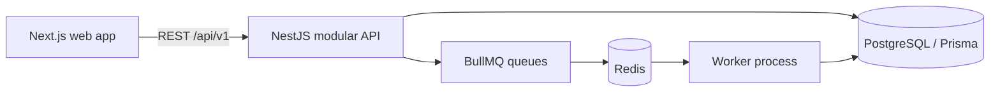

# Architecture overview

## Phase 1 boundaries

The platform is a TypeScript modular monolith. The browser calls the NestJS REST API under `/api/v1`. Domain modules own business rules and persist state through Prisma/PostgreSQL. BullMQ workers handle asynchronous tasks using Redis for transport. PostgreSQL remains authoritative: important state changes will write an outbox event in the same transaction before work is published to Redis.

## Planned module ownership

Identity and tenant context will be shared infrastructure. Customer, catalog, pricing, quotation, subscription, billing, invoice, payment, metering, credit, tax, ledger, reconciliation, notification, analytics, webhook and audit modules will own their own rules and contracts. Cross-module calls should use application services or events, not direct database access from unrelated modules.

Financial mutations will use PostgreSQL transactions, unique idempotency constraints and append-only records where history matters. Queue delivery is at-least-once; handlers must be idempotent. Invoice issue and ledger posting must never depend on Redis locks for correctness.

## Tenant isolation design

Membership is the link between a global user identity and a tenant. Tenant-owned business rows will carry `tenant_id`; tenant-scoped queries will require authenticated tenant context. Composite foreign keys and uniqueness constraints will be added to tenant-owned relationships. PostgreSQL row-level security is a planned defense in depth after request and worker tenant context propagation is in place.

No tenant authorization is implemented in the initial scaffold yet. The health route is intentionally public and contains no tenant data.
