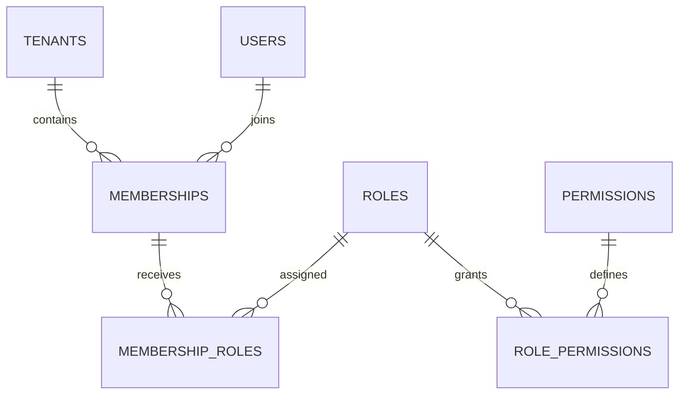

# Database design (foundation)

The initial Prisma schema establishes tenancy and RBAC identity primitives only. It intentionally does not declare billing tables ahead of their business logic.

`Tenant` stores default timezone and currency. `Membership` has a unique `(tenant_id, user_id)` key and tenant-aware composite key used by role assignments. `User` is a global identity, with tenant access granted through memberships. Platform administration is represented separately from tenant roles.

Next schema slices should introduce customer/catalog and subscription models with tenant-aware composite relations. Billing models will use integer minor units or database decimals, explicit currency, immutable finalized snapshots, and unique billing-period keys. Ledger entries will be append-only and balanced at transaction commit.

Migrations have not yet been generated. The current schema has not been applied to a PostgreSQL instance.
