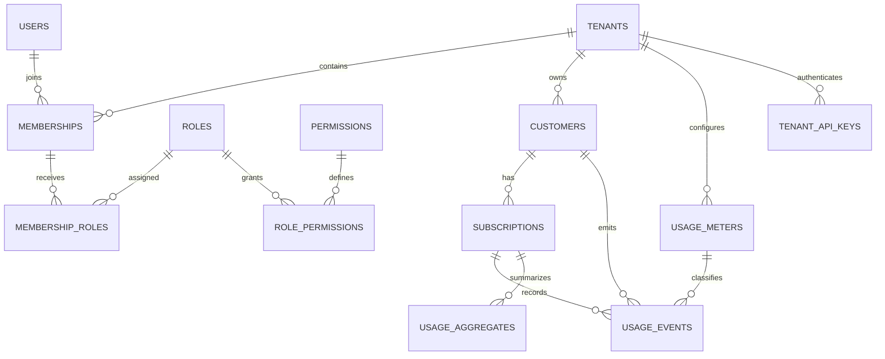

# Database design (foundation)

The Prisma schema currently establishes tenancy/RBAC primitives and the first usage-metering slice. Billing, invoicing, payments, tax, credits, and ledger models are not present yet.

`Tenant` stores default timezone and currency. `Membership` has a unique `(tenant_id, user_id)` key and tenant-aware composite key used by role assignments. `User` is a global identity, with tenant access granted through memberships. Platform administration is represented separately from tenant roles.

The first usage slice adds `Customer` and `Subscription` as intentionally minimal tenant-owned references, `UsageMeter` with pricing model and minor-unit price fields, `UsageEvent` as append-only raw telemetry, `UsageAggregate` as a rebuildable hourly/daily/billing-period projection, and `TenantApiKey` with a stored hash and scopes. Usage event IDs are globally unique; idempotency keys are unique within a tenant. Composite foreign keys prevent a usage event from referring to another tenant's customer, subscription, or meter.

The second migration installs an update/delete rejection trigger on raw events and forced RLS policies on customers, subscriptions, meters, events, and aggregates. Each tenant-facing transaction sets `app.tenant_id` locally. The runtime database role must not be a superuser or have `BYPASSRLS`; local Compose creates a restricted application role and retains the owner role for migrations only. The API key hash table is queried by exact hash during authentication and has no list endpoint.

Next schema slices should expand the minimal customer/subscription references with catalog, pricing, and lifecycle state. Billing models will use integer minor units or database decimals, explicit currency, immutable finalized snapshots, and unique billing-period keys. Ledger entries will be append-only and balanced at transaction commit.

An initial migration and an additive usage migration are committed under `apps/api/prisma/migrations`. The first was generated from an empty PostgreSQL schema; the second adds the usage slice without rewriting the original migration. They have not been applied to a PostgreSQL instance in this environment because Docker is unavailable.
